# Архитектура лабораторной «Паттерны проектирования»

Пакет: `ru.moysklad.intern.patterns` (модуль `intern`).
Диаграммы отражают классы из репозитория; методы с `TODO` помечены комментарием `%% TODO` рядом с классом.

## Место в проекте

Лабораторная изолирована от остального приложения:

- нет Spring-аннотаций — классы не попадают в контекст и не влияют на запуск приложения
  и интеграционные тесты (иначе вызов незавершённого `createDefault()` при старте сломал бы контекст);
- нет JPA, Kafka и Camunda; единственная связь с доменом — `OrderItem.fromProduct(Product, quantity)`;
- при желании сервис позже регистрируется как bean через `@Configuration`, так же как остальные сервисы проекта
  (зависимости уже передаются через конструктор).

## Общая схема расчёта заказа

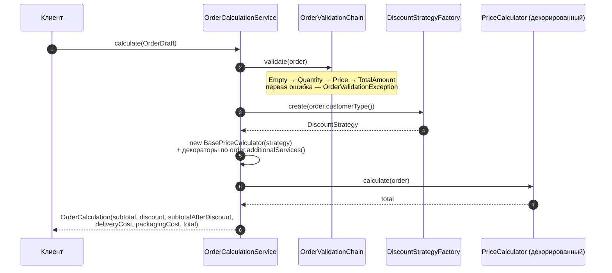

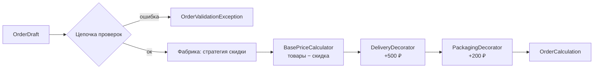

## Модель

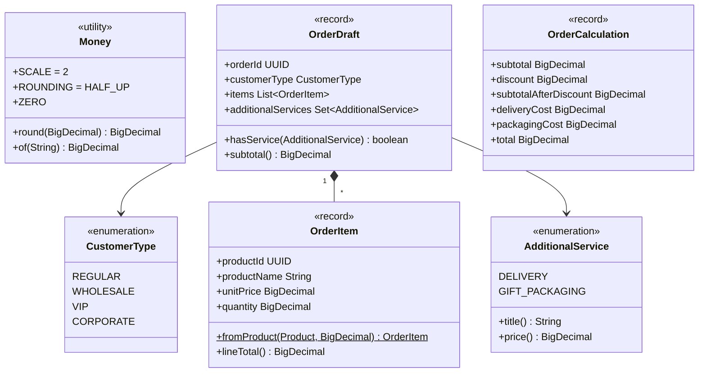

## Strategy

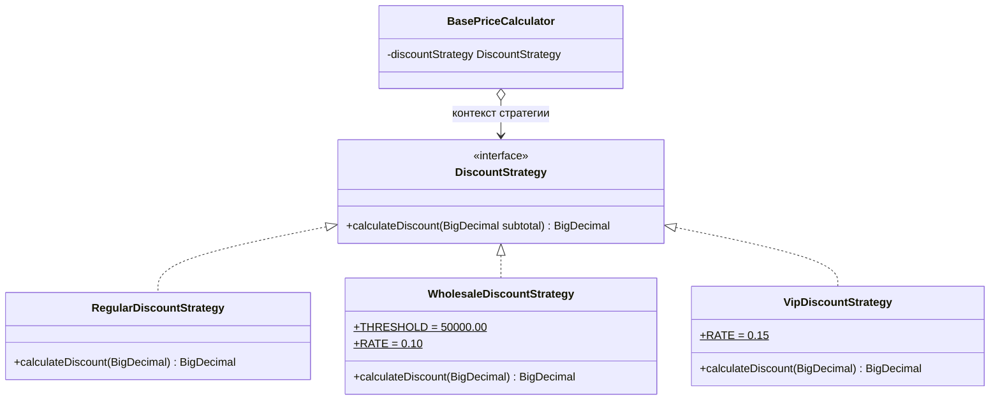

Контекст стратегии — `BasePriceCalculator`: он получает стратегию через конструктор и не знает, какая именно подставлена.

## Factory

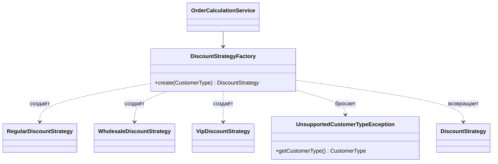

### Factory Method и Simple Factory

| | Simple Factory (эта лабораторная) | GoF Factory Method |
|---|---|---|
| Структура | Один класс с методом `create(параметр)` | Абстрактный «создатель» с фабричным методом и подклассы-создатели |
| Как выбирается продукт | По параметру (`switch` / реестр) | Подклассом, который переопределяет фабричный метод |
| Расширение | Правка одного метода фабрики (или регистрация в реестре) | Новый подкласс-создатель без правки существующих |
| Статус | Идиома, не входит в каталог GoF | Порождающий паттерн GoF |

`DiscountStrategyFactory` — **Simple Factory**. Она решает главную задачу лабораторной: убирает `new ConcreteStrategy()`
из бизнес-сервиса и собирает выбор стратегии в одном месте. Полноценный Factory Method выглядел бы так:

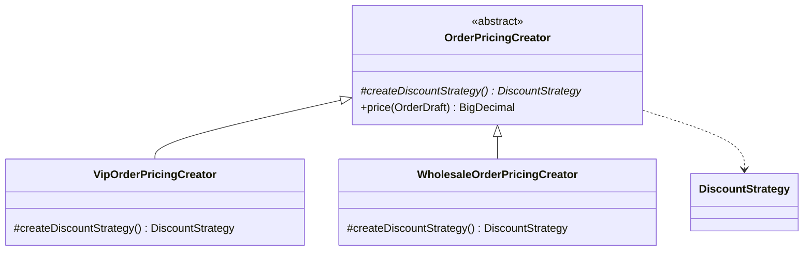

Здесь `price(...)` — общий алгоритм создателя, а какой продукт он получит, решает подкласс. В коде лабораторной этой иерархии нет,
схема приведена для сравнения на защите.

## Chain of Responsibility

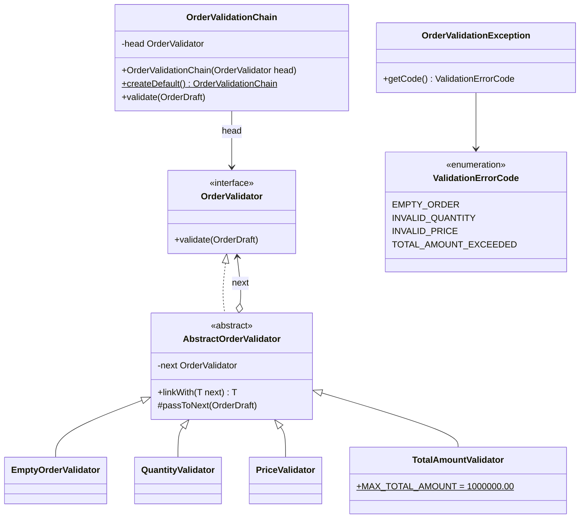

Объекты стандартной цепочки во время выполнения:

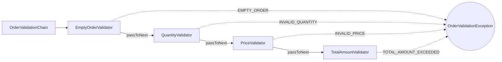

## Decorator

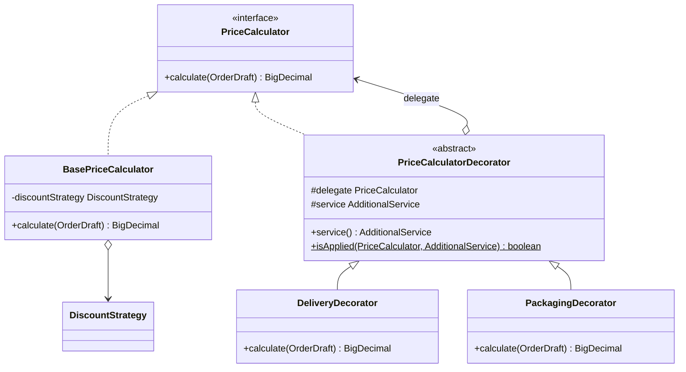

Объекты для VIP-заказа с обеими услугами:

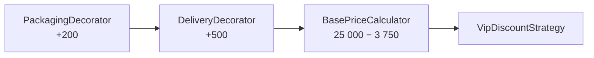

Итог: `21 250 + 500 + 200 = 21 950`. Скидка рассчитывается только внутри `BasePriceCalculator`, поэтому на услуги не влияет.

## Сервис расчёта

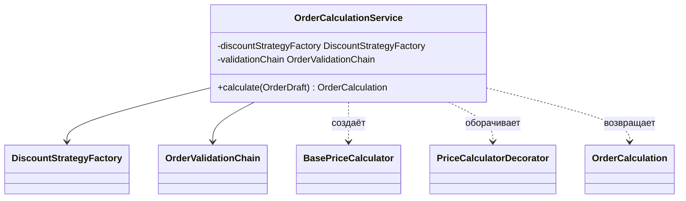

## Точки расширения

| Изменение | Что добавить | Что изменить |
|---|---|---|
| Новый тип скидки | Класс `implements DiscountStrategy` | Значение `CustomerType` и одна ветка в `DiscountStrategyFactory` |
| Новая проверка | Класс `extends AbstractOrderValidator` | Одна строка в `OrderValidationChain.createDefault()` |
| Новая услуга | Класс `extends PriceCalculatorDecorator` | Значение `AdditionalService` и одно сопоставление услуги и декоратора в сервисе |

Алгоритм `OrderCalculationService#calculate` при этом не меняется. Правка фабрики и места сборки — осознанная плата за Simple Factory
и ручную сборку; убрать её можно реестром стратегий/декораторов или DI-контейнером (список бинов `OrderValidator` с `@Order`).
