# Архитектура лабораторной

Базовый пакет: `ru.moysklad.intern.documentpatterns`.

| Пакет | Назначение | Паттерн |
|---|---|---|
| `model` | Документы, позиции, движения, статусы, коды ошибок | — |
| `repository` | Хранилище остатков в памяти, журнал движений | — (инфраструктура) |
| `factory` | Создание документа и семейства его объектов | Factory Method, Abstract Factory |
| `builder` | Пошаговое создание документа | Builder |
| `strategy` | Расчёт движений по типу документа | Strategy |
| `validation` | Проверки перед проведением | Chain of Responsibility |
| `processing` | Алгоритм проведения | Template Method |
| `decorator` | Логирование, аудит, замер времени | Decorator |
| `command` | Проведение и отмена как объекты-операции | Command |
| `state` | Жизненный цикл документа | State |
| `observer` | События документов и подписчики | Observer |
| `service` | Точка входа, объединяющая паттерны | Facade-подобный сервис |

## Единый маршрут выполнения

Каждый паттерн отвечает за одну задачу и вызывается ровно в одном месте.

```text
DocumentService.create(type, spec)
  → DocumentFactoryRegistry.forType(type)          (поиск фабрики)
  → DocumentBuilder.forFactory(factory) … build()   (Builder → Factory Method)
  → publish(DOCUMENT_CREATED)                       (Observer)

DocumentService.post(document, operationId)
  → DocumentCommandExecutor.execute(PostDocumentCommand)      (Command, идемпотентность)
    → AuditDecorator → LoggingDecorator                         (Decorator)
      → AbstractDocumentProcessor.process(document)             (Template Method)
          0. null-проверка
          1. DocumentContext.post()                              (State: планирование перехода)
          2. DocumentValidationChain.validate + validateSpecific (Chain of Responsibility)
          3. ValidationContext.plannedMovements()                (Strategy, вызывается один раз)
          4. StockRepository.apply(movements)                    (атомарно)
          5. DocumentContext.commit()                            (статус POSTED)
          6. document.recordPostedMovements(movements)
          7. publish(DOCUMENT_POSTED)                            (Observer)

DocumentService.unpost(document, operationId)
  → DocumentCommandExecutor.execute(UnpostDocumentCommand)
      1. DocumentContext.unpost()                                (State)
      2. обратные движения из getPostedMovements()
      3. StockRepository.apply(reversed)                         (атомарно)
      4. DocumentContext.commit()                                (статус CANCELLED)
      5. publish(DOCUMENT_UNPOSTED)                              (Observer)
```

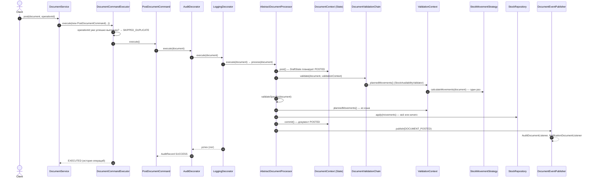

При ошибке на шагах 1–6 `commit()` не вызывается (статус прежний), `apply` не изменил хранилище,
публикуется `DOCUMENT_PROCESSING_FAILED`, исключение проходит через декораторы (лог ошибки, `AuditRecord FAILURE`)
и перехватывается исполнителем (`CommandOutcome.FAILED`, запись в истории). `DOCUMENT_POSTED` не публикуется.

### Осознанные проектные решения

- **Статус проверяет State, а не цепочка.** Правила жизненного цикла живут только в классах состояний; отдельное звено
  «допустимый статус» продублировало бы их. Состояние вызывается первым шагом шаблона, до цепочки.
- **Двухфазная смена статуса.** Состояние только планирует переход (`transitionTo`), `commit()` применяет его после
  успешного изменения остатков. Иначе ошибка остатков оставила бы документ `POSTED` без движений.
- **Стратегия вызывается один раз.** `ValidationContext` лениво вычисляет и запоминает плановые движения:
  их используют и `StockAvailabilityValidator`, и шаг применения. Если цепочка упала раньше (пустой документ),
  движения не рассчитываются вовсе.
- **Двойная проверка остатков.** Цепочка даёт понятную ошибку заранее, а `InMemoryStockRepository.apply`
  повторно проверяет итоговые остатки под блокировкой — это защищает от гонки между проверкой и записью.
- **Четыре журнала с разной ответственностью:** `AuditTrail` (попытки операций, Decorator), журнал
  `AuditDocumentListener` (события, Observer), история исполнителя (операции по `operationId`, Command),
  история хранилища (движения остатков).

---

## 1. Factory Method и Abstract Factory

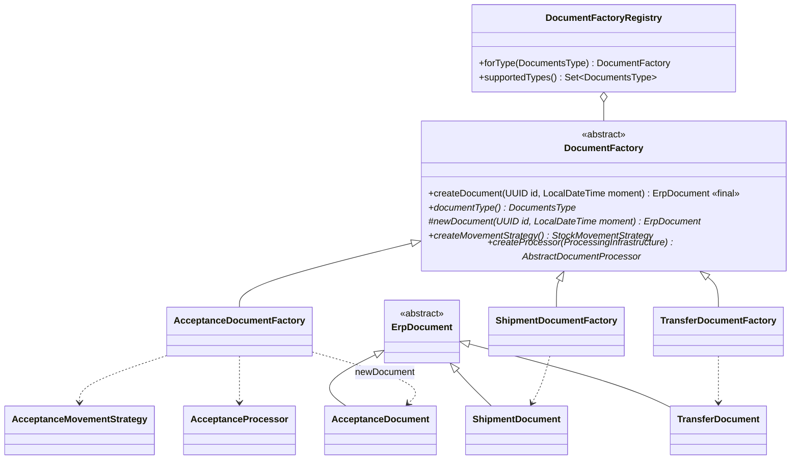

`createDocument` — общий алгоритм (проверка аргументов, вызов фабричного метода, контроль результата),
`newDocument` — фабричный метод. Методы `newDocument`, `createMovementStrategy`, `createProcessor` вместе образуют
Abstract Factory: подкласс создаёт *согласованное семейство* объектов одного типа документа.

`DocumentFactoryRegistry` — справочник «тип → фабрика», по сути Simple Factory. Это инфраструктура, а не Factory Method.

**Почему Factory Method помогает расширению.** Чтобы добавить документ «Списание», пишут `WriteOffDocument`,
`WriteOffMovementStrategy`, `WriteOffProcessor`, `WriteOffDocumentFactory` и передают фабрику в конструктор
`DocumentService`. Сервис, реестр, цепочка проверок, декораторы, команды и состояния не меняются. Сервис работает
только с абстракциями `DocumentFactory` и `DocumentOperation` — новый тип не требует нового `case`.

## 2. Strategy

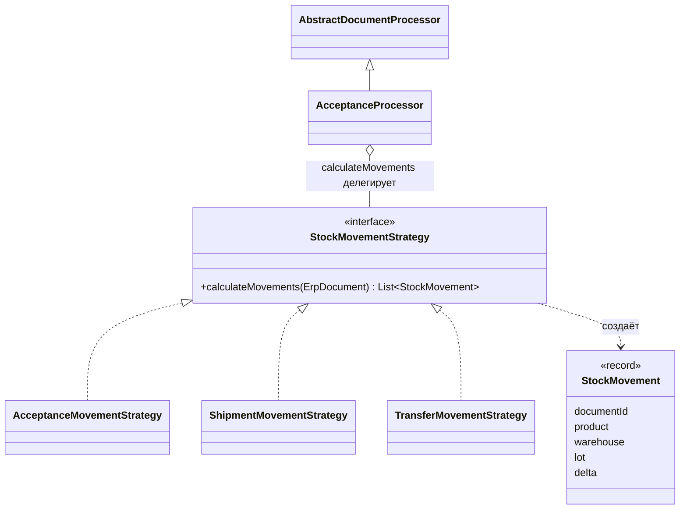

Стратегии — чистые функции «документ → движения», без доступа к хранилищу. Применение движений выполняет
только шаблонный метод.

## 3. Chain of Responsibility

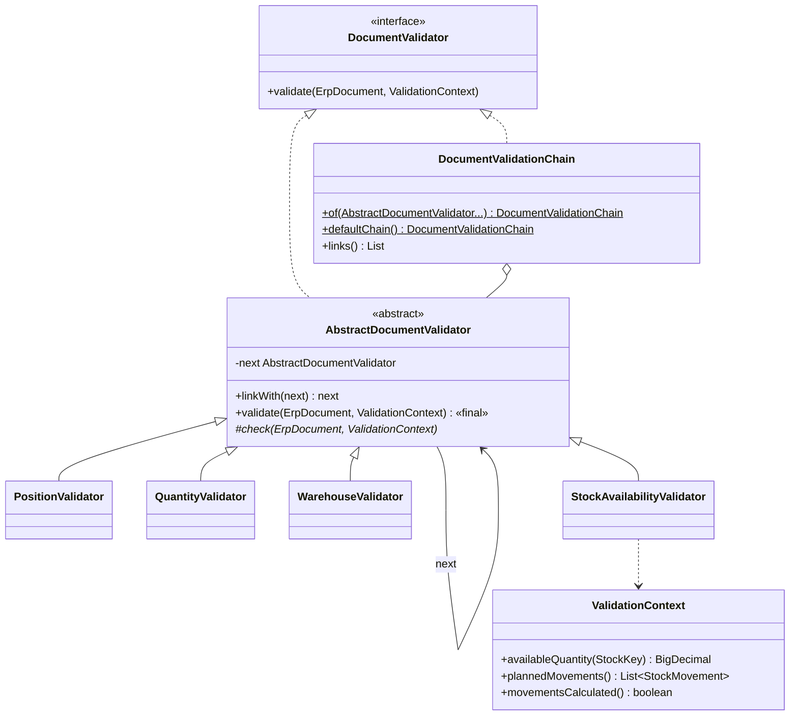

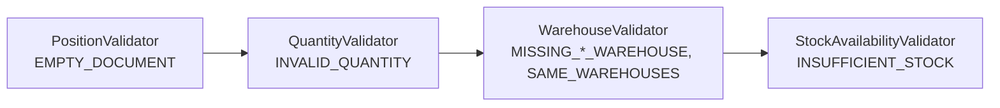

Ошибка звена — исключение `DocumentValidationException`, которое прерывает цепочку.

## 4. Template Method

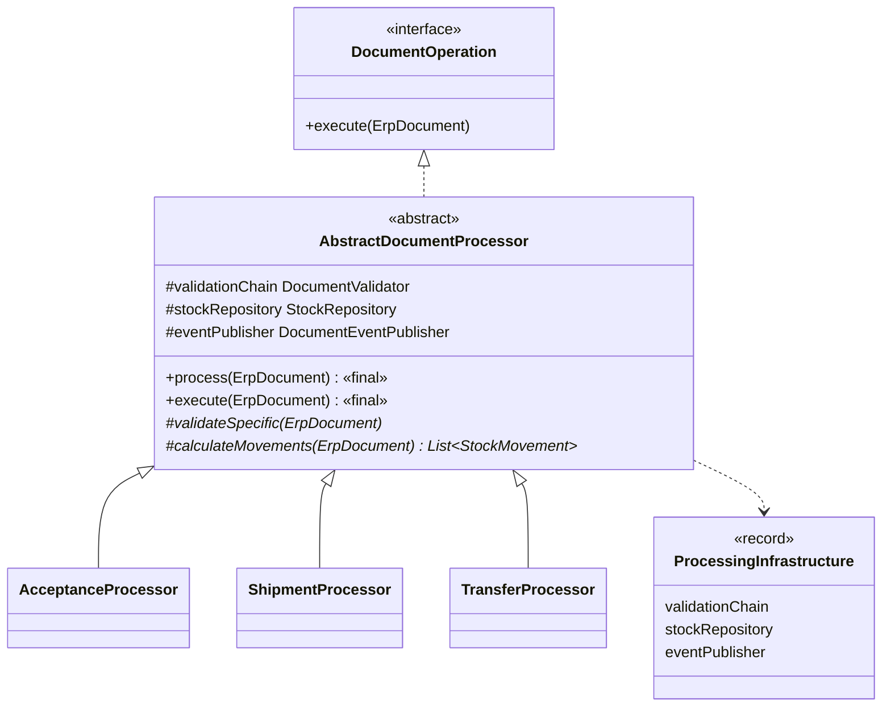

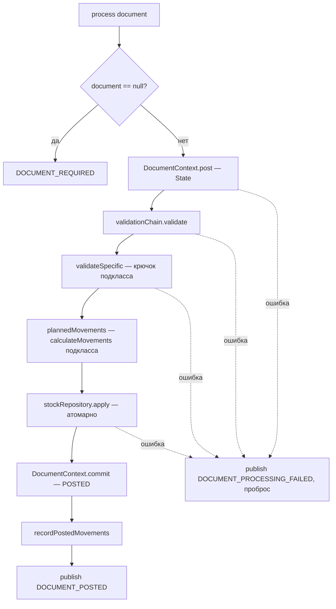

## 5. Decorator

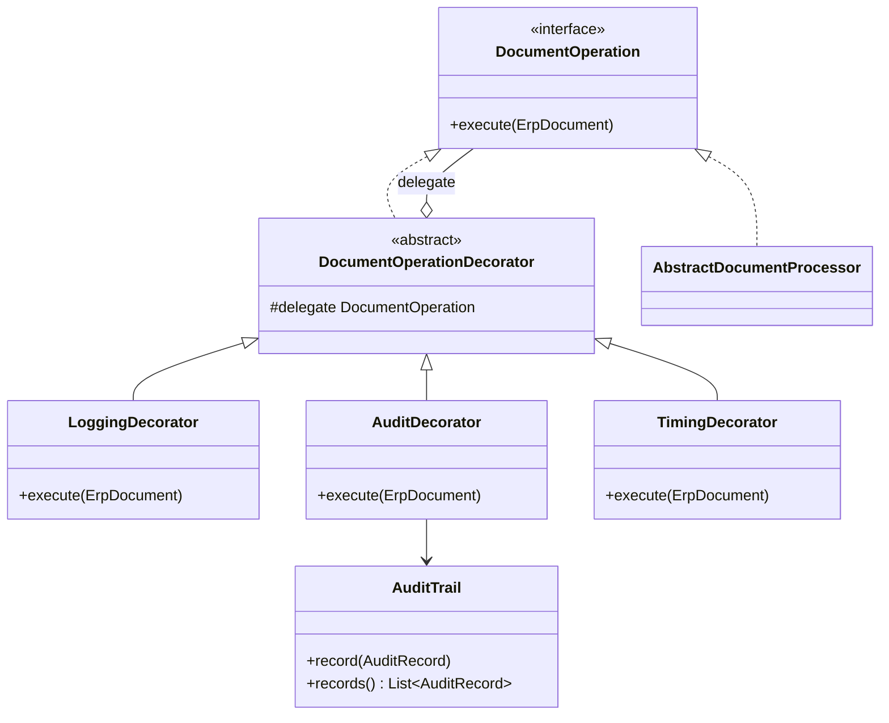

В `DocumentService` обработчик оборачивается так:
`new AuditDecorator(new LoggingDecorator(processor, log), auditTrail, "POST")`.

## 6. Command

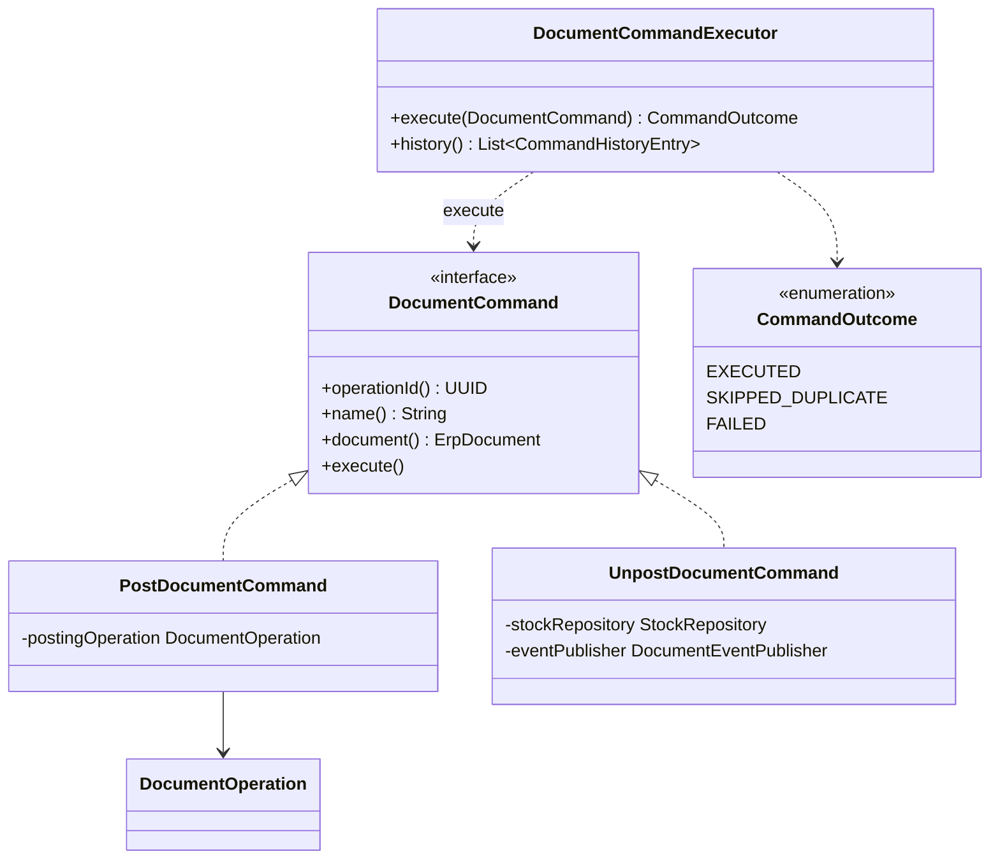

Отмена проведения — компенсирующая операция: в журнал остатков добавляются обратные движения, история не стирается.

## 7. State

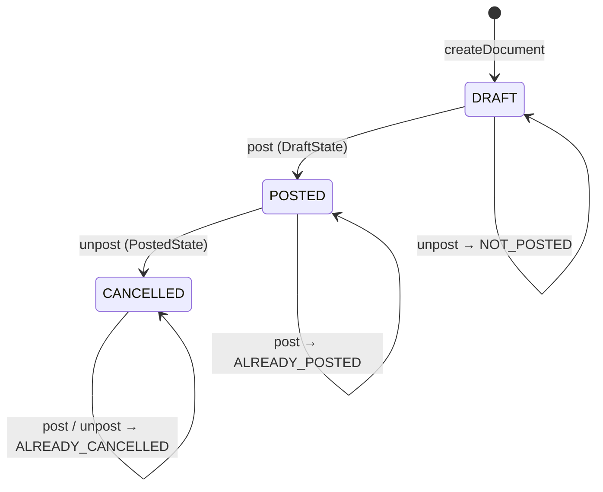

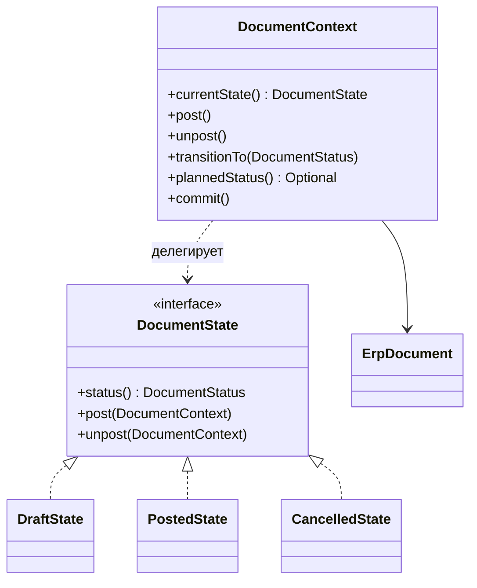

**`CANCELLED`, удаление и отмена заказа — разные вещи.**

- `CANCELLED` (учебная модель) — проведение отменено: движения сторнированы обратными, документ остаётся
  в системе с полной историей.
- Удаление — документ убирается из учёта (в реальном МойСклад — в корзину); для проведённого документа сначала
  нужно снять проведение.
- Бизнес-отмена заказа покупателя — статус заказа в его собственном процессе (например, «Отменён»); заказ может
  вообще не создавать движений остатков, а связанные отгрузки отменяются отдельно.

## 8. Observer

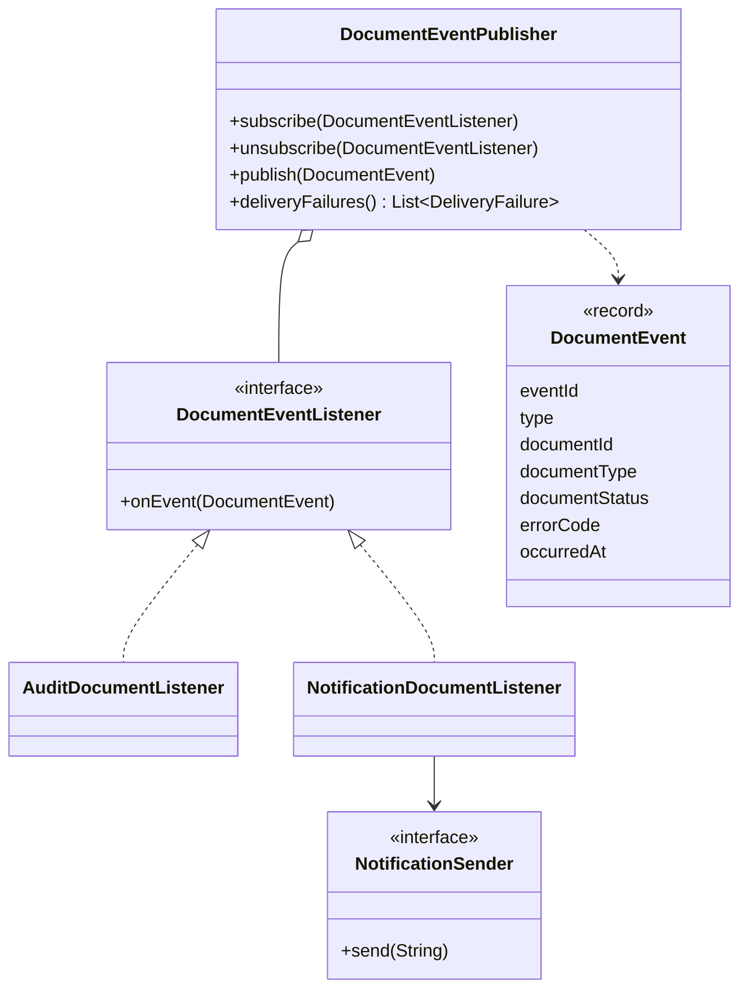

**Синхронный Observer и transactional outbox.** В лабораторной событие публикуется синхронно в том же потоке
после фиксации изменений в памяти. В системе с БД так делать нельзя: между фиксацией транзакции и доставкой
процесс может упасть (событие потеряно), а доставка до коммита может сообщить о том, что потом откатится.
Transactional outbox решает это: событие пишется в таблицу (в проекте — `outbox_event`) в той же транзакции,
что и изменения документа и остатков, а отдельный публикатор доставляет его в брокер с повторами
(«как минимум один раз»), поэтому подписчики должны быть идемпотентными по `eventId` — как в этой лабораторной.

## 9. Builder

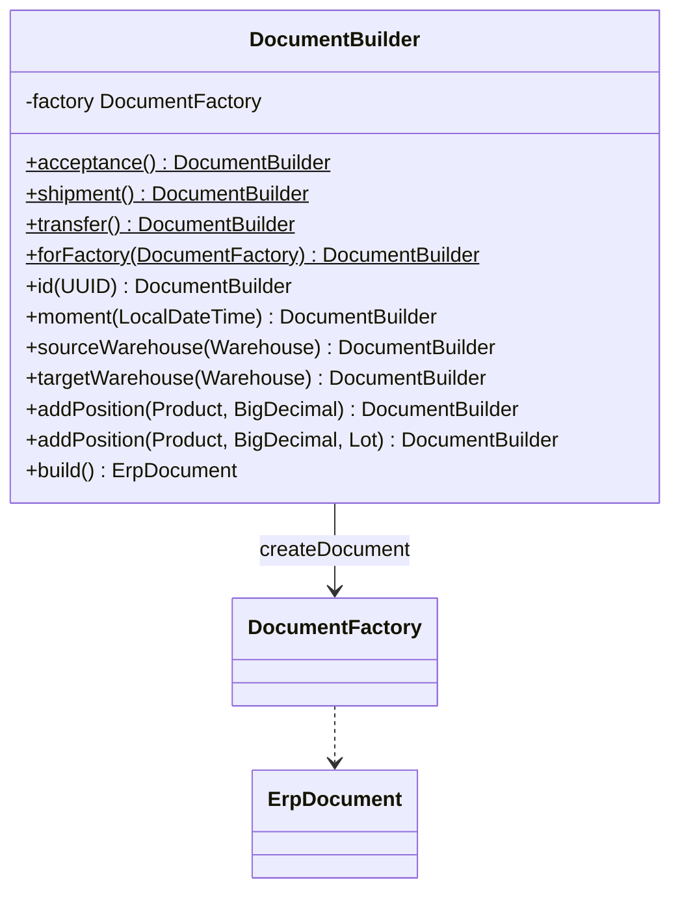

Builder отвечает за сборку и обязательные поля, Factory — за выбор конкретного класса документа.

## Объединение: `DocumentService`

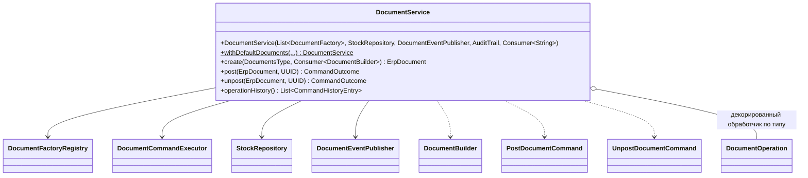

## Хранилище остатков (готово)

`InMemoryStockRepository` хранит остатки по ключу `StockKey(productId, warehouseId, lotId)`:

- `apply(movements)` под одной блокировкой суммирует дельты по ключу, проверяет, что ни один итоговый остаток
  не станет отрицательным, и только потом применяет все движения (всё или ничего);
- нехватка — `InsufficientStockException` (код `INSUFFICIENT_STOCK`), хранилище не меняется;
- каждое применённое движение попадает в журнал `history()` с порядковым номером и остатком после движения.
